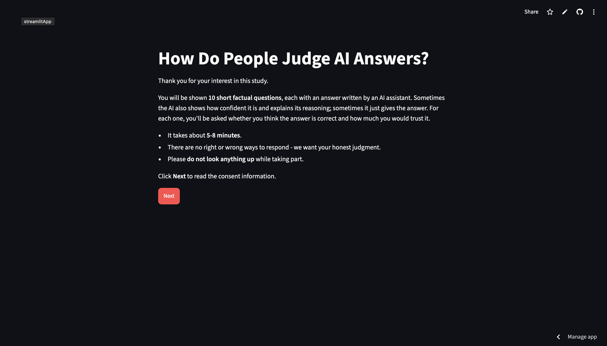

# When Should We Trust AI?

**An independent research project examining how people judge the reliability of AI-generated information, and whether their trust reflects the accuracy of the answers they receive.**

This project explores how the presentation of AI-generated answers can influence people's judgments of their reliability. In particular, it examines whether answers presented in a more polished and confident manner are trusted differently from those presented more plainly, even when their accuracy is the same.

A **Python and Streamlit-based platform** was developed to run the experiment, record anonymised responses, and support the analysis of participants' judgments, confidence, and trust.

### Project Links

🌐 [**Experiment Website**](https://ai-calibration-research-celine.streamlit.app/)

## Platform Preview

The research platform was developed using Python and Streamlit to provide an interactive environment for evaluating AI-generated information.

### Experimental Homepage

*The landing page introducing the study and its instructions.*

### Experimental Interface

*The interface where users evaluate AI-generated answers based on correctness, confidence, trust and intended reliance.*

### Completion Page

*The final page displayed upon completion of the experiment.*

📄 [**Read the Full Research Paper (PDF)**](Research%20Paper%20~%20AI%20Trust%20Calibration%20Research.pdf)

### Built With

**Python · Streamlit · Pandas · SciPy · Matplotlib · Streamlit Community Cloud**

### Key Areas

**Artificial Intelligence · Human-AI Interaction · Trust Calibration · Information Evaluation · Data Analysis**

---

*Independent research project — designed, developed, and analysed independently.*

*Developed by Celine Angelica Japardi*

**Note:** The current analysis uses simulated response data and is intended for exploratory purposes.
